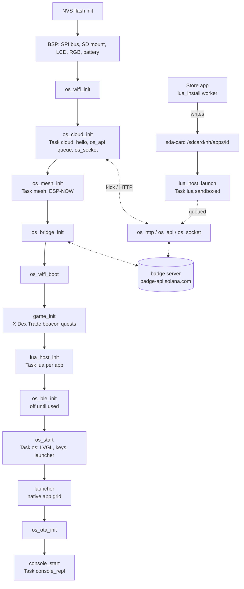

# OS architecture — Solana OS 2.1.0

> Read-only audit of `solana-foundation/solana-os` at `64a474b` (2026-11-13, 2.1.0).
> Labels: **Verified** (path:line), **Inferred**, **Unknown**.

## Boot order

Verified — `main/app_main.c:39-79`:

1. `nvs_flash_init` (+ erase recovery)
2. `bsp_spi_bus_init` -> `bsp_sd_mount`
3. `bsp_display_start` -> splash
4. `bsp_rgb_init`, `bsp_battery_init`
5. `os_wifi_init`
6. `os_cloud_init` (cloud task, `os_api`, `os_socket`)
7. `os_mesh_init` -> `os_bridge_init` -> `os_wifi_boot`
8. `game_init` (subscribes mesh, snapshots cloud)
9. `boot_sweep` (LED)
10. `lua_host_init` (registers `lua` console)
11. `os_ble_init` (BLE off until app/console)
12. `os_start` -> OS task (LVGL, app switch, keys) -> launcher
13. `os_ota_init`
14. `console_start` (built-in + `os_cmd_register`)

## Diagram

## App manager and launcher

| Piece | Behavior | Status |
|---|---|---|
| Registry | Static `os_apps[]`: wifi, badge, guide, xdex, trade, quests, beacon, store, apps, settings, about, debug, espnow, update | Verified — `main/apps/registry.c:11-26` |
| Launcher | 3x2 grid; `os_launch(app)`; HOME returns | Verified — `main/core/launcher.c:181-187`, `main/core/os.c:474-495` |
| OS task | Queue-driven keys, launch, tick, status bar | Verified — `main/core/os.c:672-681` |
| Lua apps | Hidden `lua_host_app`; `lua_host_launch(id)` spawns Task `lua` | Verified — `main/lua/lua_host.h:37-43` |
| Settings | NVS `settings`: theme/brightness/LCD | Verified — `main/core/os_settings.c:15-20` |
| Data root | `/sdcard/hh/` via `OS_DATA_DIR` | Verified — `main/core/os_data.h:14` |

## Lua host sandbox and limits

Std libs allowlisted to `base, coroutine, string, table, math, utf8`; `dofile`, `loadfile`, `load`, `warn` removed; no `io/os/debug/package` — Verified `main/lua/lua_host.c:429-449`. Globals (`led, timer, sys, badge, storage, wifi, json, ui, mesh, lamps, ...`) opened via `lh_open_*`, network ones permission-gated — Verified `lua_host.c:459-466`.

| Limit | Value | Status |
|---|---|---|
| Lua heap (PSRAM, 2.x) | 6 MiB max | Verified — `main/lua/lua_host.h:28` |
| PSRAM reserve while app runs | 512 KiB | Verified — `lua_host.h:29` |
| Lua heap (no PSRAM, pre-2.0) | 96 KiB (48 KiB below 0.5.13) | Verified — `lua_host.h:30` (+ `docs/LUA_API.md` limits table) |
| SRAM reserve (UI check) | 32 KiB | Verified — `lua_host.h:31` |
| VM instructions / callback | 200,000 (coroutines + patterns included) | Verified — `lua_host.h:32` |
| Lua task stack | 12 KiB | Verified — `lua_host.c:48` |
| C-stack guard | warn 4096 B / hard 2048 B remaining | Verified — `lua_host.c:49-50` |
| Hook interval | 1000 insns | Verified — `lua_host.c:52` |
| `LUAI_MAXCCALLS` / pattern | 64 / 32 | Verified — `lua/vendor/luaconf.h:765-771` |
| UI objects | 128 (64 below 2.0), one QR max; label text 200 B/label, 12 KiB total | Verified — `lua_priv.h:27,42-43` |
| Timers | 8, min 20 ms; tick 30 ms (50 ms pre-2.1) | Verified — `lua_priv.h:47-49`, `LUA_API.md` lifecycle |
| `storage` | 16 KiB/app | Verified — `lua_priv.h:50` |
| `mesh.send` | 4/s, 200 B JSON; meets 1 asked + 1 accepted/s, 100 B data/side, 300/day/app, 40 outbox | Verified — `lua_priv.h:52-53`, `LUA_API.md` limits |
| Server calls queued / app | 16 (`busy` after) | Verified — `lua_priv.h:55` |
| Bundled files | 64 x 256 KiB, 1 MiB total; `main.lua` ≤ 64 KiB; `fs.read` ≤ 256 KiB | Verified — `lua_pkg.h:19-23`, `lua_pkg.h:17`, `LUA_API.md` |
| HTTP / RPC / WS caps | 60/min + 2 KiB req + ~3.5 KiB resp + 6 s; RPC 30/min (6 sends); WS 1 socket, 4 KiB/msg, 8 queued, 20 opens/min | Verified — `docs/LUA_API.md:127-141`, `docs/CONNECTIVITY.md:69-77` |
| BLE values | 1 link, ≤244 B, 4 waiting, ≤4 chars/service, adv ≤24 B | Verified — `LUA_API.md` BLE + limits |
| Crypto costs | verify 40k, on_curve 5k, PDA 10k insns | Verified — `LUA_API.md` crypto table |

## Permissions

Bits in `app.json` `"permissions"` -> `lua_pkg_t.perms`, enforced by `lh_need_perm()` — Verified `main/lua/lua_pkg.h:27-38`, `lua_host.c:95-98`.

| Permission | Bit | Human text (store UI) | Typical APIs | Status |
|---|---|---|---|---|
| `led` | 0 | Light the LEDs | `led.*` | Verified — `lua_pkg.c:20-35` |
| `wifi` | 1 | Turn Wi-Fi on and off | `wifi.*` | Verified |
| `mesh` | 2 | Talk to nearby badges | `mesh.*`, meets | Verified — `lua_net.c:33-45` |
| `lamps` | 3 | Spend and earn !LAMPs | `lamps.*` | Verified — `lua_net.c:37-39` |
| `items` | 4 | Create and read items | `items.*` | Verified |
| `profile` | 5 | See your profile | `profile.*` | Verified |
| `quest` | 6 | Report quest progress | `quest.*` | Verified |
| `http` | 7 | Talk to servers | `http.*`, `ws.*` | Verified — `LUA_API.md:1213` (`ws` uses `http` perm) |
| `rpc` | 8 | Read/send Solana | `rpc.*` | Verified — `LUA_API.md:1387` |
| `ble` | 9 | Bluetooth devices | `ble.*` | Verified — `LUA_API.md:702` |

`hosts` (HTTP/WS allowlist, ≤8, `*.example.com` covers subdomains only, no IP/port/path) is manifest-only — Verified `lua_pkg.h:112-118`, `LUA_API.md:1040-1045`. Store prewarm: apps with server perms may wait up to 4000 ms for connection at launch — Verified `lua_host.c:58-59,637-645`.

Two enforcement layers: sync module entry (`lh_need_perm` -> Lua error) and async server path (`start_ex` / `ws.open` -> `cb(false, "denied")`) — Verified `lua_host.c:95-99`, `lua_net.c:193-198`, `lua_ws.c:330`.

## Identity (summary; full flow in code)

NVS namespace `cloud` holds server URL, badge `id`, bearer `secret`, mesh `key`, owner label/user tag, `claimed`, lamps/level/packs — Verified `os_cloud.c:706-734`. First/subsequent hello `POST {server}/api/badge/hello` with `hw = prefix + STA MAC`, `fw`, `model bp26`, `needKey` — Verified `os_cloud.c:331-340,49-54`. Server 200 must include `id` (-> `badge.id()`, nil before) — Verified `os_cloud.c:304-310,429-431`, `lua_sys.c:278-287`. `claimed:false` -> UNCLAIMED + QR (`badge_app.c:1-5,61-74`); `claimed:true` -> owner label + ≤8-char user tag (`os_cloud.c:190-222,465-483`); owner change wipes `/sdcard/hh` (`os_cloud.c:364-398`); 409 `linked:true` when secret lost (`os_cloud.c:245-255`); `reset yes` erases NVS + card and reboots (`os_cloud.c:572-594,692-700`). Lua sees only `badge.id()`, `badge.owner()` (claimed only), `badge.online()` (Wi-Fi + registered + no app WS) — Verified `lua_sys.c:278-305`, `os_api.c:85-88`. No Solana keypairs on device — Verified `lua_crypto.c:5-7`.

Note: `main/core/os_keys.h` is the **button map**, not crypto — Verified `os_keys.h:1-19`.

## Store install and compile pipeline

Worker task does one download at a time (`os_api` callback hands over), OS task never blocks on card/network — Verified `lua_install.c:1-18`, `lua_install.c:19-...`:

1. `main.lua` into `apps/<id>.new/`, manifest from `X-App-Manifest` header;
2. bundled-file index (`files?v=`), copy-by-hash or download with SHA check;
3. `code.bin` (store-compiled, label `LUA_SOLANA_LUAC` = `5.5.1-sol.1`) kept/downloaded like a file — Verified `lua_code.c:1-20`, `vendor/luaconf.h:802`;
4. `app.json` + copy over installed `data.json`;
5. atomic swap `apps/<id>` -> `.old`, `.new` -> live, remove `.old` (power-cut recovery via `lua_install_recover()`); requests pinned to manifest version; one install at a time; survives store close with toast.
6. On-device load: if manifest `code` label + SHA match, XIP-map `code.bin`; else compile `main.lua` (`"t"`) — Verified `lua_code.c:57-77`, `lua_host.c:409-422`.

Card takes 5 open files max (`bsp_sd.c`); worker holds ≤2 — Verified `lua_install.c` header comment.

`luac` runs only in the store build tool, not at badge runtime except as fallback — Verified `tools/luac/luac.c:1-5`.

## OTA

Offer in hello (`update`, `update_sha`, `update_size` -> `os_cloud_info_t`) — Verified `os_cloud.h:45-49`. Download to `/sdcard/ota/solana-os.bin` via `os_api_download` on cloud task — Verified `os_ota.c:36-37,3-4`. Battery gate ≥70% (`OS_OTA_MIN_BATTERY` — Verified `os_ota.h:17`). Worker flashes inactive OTA slot, reboot; `os_ota_init` marks good — Verified `os_ota.h:8-12`. Console: `ota` — Verified `os_ota.c:342`.

## Server link (cloud / bridge / HTTP / WS / socket)

| Component | Role | Status |
|---|---|---|
| `os_cloud` | Hello loop, NVS identity, state machine, factory reset | Verified — `os_cloud.c:1-15` |
| `os_api` | Queued authenticated `/api/device/*`, bearer from `os_cloud_bearer` | Verified — `os_api.h:1-9` |
| `os_http` | Single TLS connection, Bearer header, shared with hello | Verified — `os_http.c:59,176-187` |
| `os_socket` | App WebSocket; while open `os_api_online()` false | Verified — `os_socket.h:9`, `os_api.c:85-88` |
| `os_ws` | Device-layer WS | Verified — `sources.cmake:45` |
| `os_bridge` | Server-mediated mesh between distant badges | Verified — `CONNECTIVITY.md:40-43` |
| Registration | server + id + secret | Verified — `os_cloud.c:772-777` |

Badge API base for app servers: `https://badge-api.solana.com/api/...` (NOT the store origin, which 429s scripts) — Verified `LUA_API.md:150-162`.

## Console commands

Portable table, max 16 commands — Verified `os_cmd.c:9-21`. Built-ins: `info, sd, ls, cat, rgb, apps, open, key, wifi, server, cloud, shot, heap, reboot` — Verified `console.c:368-392`; plus `reset, api, outbox, ble, bridge, mesh, ota, beacon, quest, trade, xdex, lua` via `os_cmd_register` grep. `cloud` prints state/id/owner/claim URL/HTTP stats — Verified `console.c:275-299`. `shot` -> base64 RGB565 for `tools/badge.py` — Verified `os.c:519+`.
